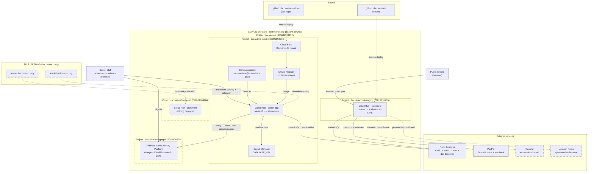

# BCC Rentals

The Bachman Community Center rents out equipment and facilities — tables, chairs, tents, rooms,
and similar — to the community. **BCC Rentals** is the software that runs that program. It
has two halves that share one database:

| Half | Repo | Who uses it | What it does |
| --- | --- | --- | --- |
| **Storefront** | [`bcc-rentals-frontend`](https://github.com/thedavidhanks/bcc-rentals-frontend) | The public | Browse the catalog, check availability, book and pay (PayPal) |
| **Admin app** | **this repo** (`bcc-rentals-admin`) | Center staff | Manage the catalog, prices, categories, users, and the reservation calendar |

Both are Next.js apps on **Google Cloud Run**, backed by the **same Neon Postgres
database**. That shared database is the single source of truth: a staff member blocking out
twenty chairs in the admin app and a customer booking those same chairs on the storefront
are writing to the same rows, within seconds of each other. Most of the design constraints
in this repo come from that one fact.

GCP lives under the **`bachmancc.org` organization** (`513346324292`) → folder
**`bcc-rentals`** (`873642981137`) → four projects, one per app per environment.

---

## This repo: the admin app

An authenticated, staff-only web app for administering the rentals catalog and calendar.
It is a **second writer** to the storefront's tables; it changes nothing about the
storefront itself. Catalog and price edits show up on the storefront within ~30 seconds (its
catalog cache TTL) with no redeploy.

### What staff can do

| Capability | Scheduler | Admin |
| --- | :--: | :--: |
| View catalog, categories, calendar | ✅ | ✅ |
| Block items out on the calendar (staff holds) | ✅ | ✅ |
| Create / edit / cancel reservations (multi-product, recurring) | ✅ | ✅ |
| Set and edit item prices | ✅ | ✅ |
| Add / edit / deactivate products | ❌ | ✅ |
| Add / edit categories and category assignments | ❌ | ✅ |
| Manage users and roles | ❌ | ✅ |

Payments and refunds stay in the storefront's PayPal flow — the admin app never touches
money movement.

Screens: `/calendar` (landing view, week + month), `/reservations/new`,
`/reservations/[groupId]`, `/products`, `/prices`, `/categories`, `/users`, `/profile`,
`/login`.

### Three rules that will corrupt data if ignored

1. **Reservation writes must be race-safe.** The storefront books these rows under a
   per-item Postgres advisory lock (`pg_advisory_xact_lock`). Every reservation write here
   uses the identical pattern — lock → re-check buffered-window capacity → insert — in one
   transaction, locks acquired in stable slug order for multi-item bookings, all-or-nothing.
   Skip it and a staff block plus a customer booking can both claim the last unit.
2. **Money is integer cents; time is minutes since local midnight in `America/New_York`.**
   No floats, no stored UTC offsets. `days_of_week` is `smallint[]` (`0=Sun..6=Sat`, `null`
   = every day). Reservation `start_at`/`end_at` are real `timestamptz` instants — converted
   to Eastern only for display and hours validation.
3. **Don't assume users have Google accounts.** Identity is Firebase Authentication / GCP
   Identity Platform and is provider-agnostic. The Firebase **UID** is the durable account
   id; `app_users.role` in Postgres is the canonical permission store. Every mutating route
   and server action re-checks the role server-side (`requireScheduler` / `requireAdmin`) —
   hidden UI is never the control.

---

## Architecture



**Legend**

- **Grey line** — belongs to the storefront (public website) side of the system.
- **Dashed outline** — not deployed yet.
- Solid, non-grey — the admin app side, deployed or live today.

---

## Components

### People and clients

**Public renters** · browser → the storefront. Browse the catalog, check availability, book,
pay. Never touch the admin app.

**Center staff** · browser → the admin app. Two roles, `scheduler` and `admin`, stored in
`app_users.role` in Postgres.

### Hosting — GCP folder `bcc-rentals`

Every project sits on billing account `bachmancc-billing`, has `run`, `artifactregistry`,
`identitytoolkit`, `secretmanager`, `iam`, and `cloudbuild` enabled, and has its own
least-privilege `run-runtime@<project>.iam.gserviceaccount.com` service account.

**`bcc-admin-prod` (305395393303)** — the admin app's deploy target.
- *Cloud Run service (admin app)* — **not deployed yet** (issue
  [#5](https://github.com/thedavidhanks/bcc-rentals-admin/issues/5)). Will run `us-east1`,
  scale-to-zero, `output: 'standalone'` container on port 8080, deployed **as the
  `run-runtime` SA** rather than the default compute SA. `--allow-unauthenticated` at the
  platform layer — the **app** is the gate: middleware verifies the Firebase session cookie
  and the `app_users` lookup authorizes.
- *Secret Manager* — holds the `DATABASE_URL` secret; `run-runtime` has `secretAccessor` on
  it. Live today.
- *Artifact Registry + Cloud Build* — `gcloud run deploy --source .` builds the repo
  `Dockerfile` in Cloud Build and stores the image in Artifact Registry. No local Docker
  needed.

**`bcc-admin-staging` (612782676839)** — **no Cloud Run service deployed**, but its
*Firebase Authentication / Identity Platform* tenant is live and is what both local
development and the eventual production app authenticate against. Enabled sign-in methods
for launch: **Google** and **Email/Password** (GitHub / Facebook / Apple deferred until
their OAuth apps are registered). Provides identity only — the Firebase UID. Permissions
come from Postgres.

**`bcc-storefront-staging` (78017895905)** — the only **live** storefront deployment:
`https://bcc-rentals-78017895905.us-east1.run.app`, Cloud Run `us-east1`, scale-to-zero.

**`bcc-storefront-prod` (259601604284)** — created, **nothing deployed**. The storefront's
original personal-account deployment was never migrated into the org: the org enforces
domain-restricted sharing (`iam.allowedPolicyMemberDomains`), which blocks moving an
externally-owned project in. Keep every IAM member `@bachmancc.org`;
`--allow-unauthenticated` still works because the `allUsers` invoker binding is exempt from
that constraint.

### Data

**Neon Postgres** · hosted by Neon on AWS `us-east-1` (Cloud Run is in `us-east1` to
co-locate). The single source of truth for both apps.
- Runtime uses the **pooled** endpoint (`DATABASE_URL`); `DATABASE_URL_DEV` is the dev-branch
  direct endpoint for one-off DDL and tooling only. Access via `pg` `Pool`; multi-statement
  writes are wrapped in a transaction.
- *Storefront-owned tables:* `items`, `item_prices`, `categories`, `item_categories`,
  `reservations`.
- *Admin-added tables* ([`db/schema.sql`](db/schema.sql)): `app_users`,
  `reservation_series`, `reservation_groups`, `reservations.group_id` /
  `reservations.series_id`, and `admin_audit_log`. All idempotent. Applied to both the
  **dev** and **prod** Neon branches.
- Conventions: deactivate rather than delete (`items.active=false`,
  `reservations.status='cancelled'`), bump `items.updated_at` on every edit, and write an
  `admin_audit_log` row on **every** mutation.

### External services (storefront side)

**PayPal** · PayPal-hosted. Smart Buttons checkout plus a webhook into the storefront. The
admin app has no PayPal integration and needs no PayPal environment variables.

**Resend** (transactional email) and **Upstash Redis** (pending-order state, fulfill locks,
webhook dedup) · both appear in the superseded
[ARCHITECTURE_PLAN_B.md](docs/ARCHITECTURE_PLAN_B.md), and their status in the current
storefront is **unconfirmed** — treat them as possible future milestones rather than live
dependencies. Neither is used by the admin app.

### DNS

**GoDaddy** is the registrar for `bachmancc.org`.

- `admin.bachmancc.org` → **not mapped yet** (issue
  [#6](https://github.com/thedavidhanks/bcc-rentals-admin/issues/6)). Mapping it requires a
  Cloud Run domain mapping plus adding the host to Firebase **Authorized Domains** and each
  provider's OAuth callback list. Confirming DNS control is the last open question (Q4).
- `rentals.bachmancc.org` → the storefront's intended public URL. It does **not resolve** as
  of 2026-10-10; the storefront is reachable only at its Cloud Run URL.

### Source and CI

Two GitHub repos, both public. Deploys are `gcloud run deploy --source .` from a developer
machine — there is no automated CI/CD pipeline. Shared TypeScript lives in this repo's
`packages/scheduler` workspace (`@bcc/scheduler`), consumed with no build step via npm
workspaces + `tsconfig` paths and `transpilePackages`.

---

## Local development

### Prerequisites

The repo ships a **devcontainer** ([`.devcontainer/devcontainer.json`](.devcontainer/devcontainer.json),
Node 22, with `gh` and `gcloud` preinstalled) — open the folder in VS Code and "Reopen in
Container" for a working toolchain. Without it you need Node 22+ and, for the GCP/Firebase
bits, the `gcloud` CLI.

### Setup

```bash
npm install                  # node_modules is not committed
cp .env.local.example .env.local
```

Then fill in `.env.local`. **It holds live production credentials — never commit it, never
paste its contents into a PR, log, issue, or agent prompt.** The variables, validated with
Zod at boot (the app refuses to start if a required one is missing — see
[`lib/env.ts`](lib/env.ts) and [`lib/public-env.ts`](lib/public-env.ts)):

| Variable | Required | Notes |
| --- | :--: | --- |
| `DATABASE_URL` | ✅ | Neon **pooled** endpoint. The running app authorizes against this one only. |
| `DATABASE_URL_DEV` | — | Neon dev-branch direct endpoint, for DDL/tooling. |
| `NODE_ENV` | — | `development` locally, `production` on Cloud Run. |
| `NEXT_PUBLIC_SITE_URL` | ✅ | The admin app's own URL. |
| `NEXT_PUBLIC_FIREBASE_API_KEY` | ✅ | Web SDK config. Not secret, but inlined at **build** time *and* read at runtime — supply to both. |
| `NEXT_PUBLIC_FIREBASE_AUTH_DOMAIN` | ✅ | ″ |
| `NEXT_PUBLIC_FIREBASE_PROJECT_ID` | ✅ | ″ |
| `NEXT_PUBLIC_FIREBASE_APP_ID` | ✅ | ″ |
| `NEXT_PUBLIC_FIREBASE_MESSAGING_SENDER_ID` | — | Only if Cloud Messaging is used. |
| `FIREBASE_PROJECT_ID` | ✅ | Admin SDK project id (same project as the Web SDK). |
| `GOOGLE_APPLICATION_CREDENTIALS` | — | **Local dev only.** On Cloud Run, leave unset and use the runtime SA's ADC. |
| `ALLOWED_EMAIL_DOMAIN` | — | Optional guard layered on top of the `app_users` lookup (e.g. `bachmancc.org`). |
| `AUTH_DEV_BYPASS` | — | `on`/`off`. Non-production only; shows a role picker instead of real sign-in. Always ignored in production. |

### Firebase credentials for local sign-in

`lib/auth/session.ts` calls `createSessionCookie()`, which needs a credential that can
**sign** — a plain user ADC cannot. Mint an impersonated-service-account credential:

```bash
npm run gcp:adc              # scripts/gcp/refresh-admin-adc.sh
```

It signs you in (as `gcp-admin@bachmancc.org`) inside a throwaway `CLOUDSDK_CONFIG`, so your
default ADC is never overwritten, and writes `~/.config/gcloud/bcc-admin-adc.json`. Point
`GOOGLE_APPLICATION_CREDENTIALS` at that path. `--help` lists the options.

Because `.env.local`'s `DATABASE_URL` points at the **prod** Neon branch and the Firebase
tenant is `bcc-admin-staging`, real end-to-end sign-in works on `localhost` today with no
deploy. (The dev branch has zero `app_users` rows — only add one there if you repoint
`DATABASE_URL` at dev.)

### Commands

```bash
npm run dev            # dev server on :3000
npm run build          # standalone production build
npm run lint           # eslint
npm run typecheck      # tsc --noEmit
npm test               # vitest run
npm run db:apply       # apply db/schema.sql to DATABASE_URL_DEV (dev branch)
npm run gcp:adc        # refresh the local Firebase Admin credential
```

### Working on the schema

`npm run db:apply` targets the **dev branch first**, always, and refuses prod unless
`APPLY_TO_PROD=1`. One gotcha: the script **prefers `DATABASE_URL_DEV` whenever it is set**,
so targeting prod means clearing it for that one call:

```bash
DATABASE_URL_DEV= APPLY_TO_PROD=1 npm run db:apply
```

Never run DDL against prod without an explicit human go-ahead.

### Conventions

- `import "server-only"` in any module that touches the database or secrets.
- Import the shared scheduler/product surface from `@bcc/scheduler`; don't re-duplicate it.
- Match the storefront's row shapes when reading or writing shared tables.
- `git merge` requires human approval in this repo; branches are built and verified, then a
  human merges.

---

## Where things stand (2026-10-10)

**Done.** Data layer, race-safe reservation engine, typed repositories, audit logging, real
Firebase auth end to end (client + server, session cookies, role guards), and all the
screens: calendar (week + month, grouping, filters), reservations, products, prices,
categories, users, profile. The §5 schema is applied to both the dev and prod Neon branches,
and a first `role=admin` row exists in prod. 524 tests across 31 files, all passing.

**Not done.** The app has never been deployed. It runs locally against the production
database and staging Firebase tenant.

| Phase | Scope | State |
| --- | --- | --- |
| P0–P5 | Foundation, data layer, reservation engine, repositories, auth, app shell | ✅ Complete |
| P6 | Screens: reservations, products, prices, categories, users | Screens done; [#17](https://github.com/thedavidhanks/bcc-rentals-admin/issues/17), [#1](https://github.com/thedavidhanks/bcc-rentals-admin/issues/1), [#2](https://github.com/thedavidhanks/bcc-rentals-admin/issues/2) open |
| P7 | Cross-system verification against the live storefront | [#3](https://github.com/thedavidhanks/bcc-rentals-admin/issues/3) open |
| P8 | Deploy to Cloud Run + domain + smoke test | [#4](https://github.com/thedavidhanks/bcc-rentals-admin/issues/4) → [#5](https://github.com/thedavidhanks/bcc-rentals-admin/issues/5) → [#6](https://github.com/thedavidhanks/bcc-rentals-admin/issues/6) → [#7](https://github.com/thedavidhanks/bcc-rentals-admin/issues/7) |
| P9 | Shared-code consolidation (`@bcc/scheduler`) | Package exists; [#8](https://github.com/thedavidhanks/bcc-rentals-admin/issues/8), [#9](https://github.com/thedavidhanks/bcc-rentals-admin/issues/9) open |
| P10 | GCP org and project structure | Org + 4 projects ✅; [#10](https://github.com/thedavidhanks/bcc-rentals-admin/issues/10), [#11](https://github.com/thedavidhanks/bcc-rentals-admin/issues/11) optional |
| P11 | UX polish and first-use fixes | 8 of 10 done; [#12](https://github.com/thedavidhanks/bcc-rentals-admin/issues/12), [#16](https://github.com/thedavidhanks/bcc-rentals-admin/issues/16) open |

### Roadmap from here

**Launch-critical path, in order:**

1. [#4](https://github.com/thedavidhanks/bcc-rentals-admin/issues/4) — adapt the deploy
   runbook from the storefront's PayPal version to the admin app's Firebase / no-payment one.
2. [#5](https://github.com/thedavidhanks/bcc-rentals-admin/issues/5) — deploy to Cloud Run in
   `bcc-admin-prod`, secrets in Secret Manager.
3. [#6](https://github.com/thedavidhanks/bcc-rentals-admin/issues/6) — map
   `admin.bachmancc.org`, add it to Firebase Authorized Domains and the provider callbacks.
4. [#7](https://github.com/thedavidhanks/bcc-rentals-admin/issues/7) — production smoke test:
   sign in per provider, create a block, confirm the storefront reflects it.

Also launch-relevant but needing no deploy:
[#3](https://github.com/thedavidhanks/bcc-rentals-admin/issues/3) — verify an admin-created
block reaches the storefront within ~30s and blocks a conflicting booking.

One identity change is in flight: the bootstrapped admin is still a Gmail identity, being
swapped for a `@bachmancc.org` one. The replacement Firebase user already exists; the
idempotent swap SQL and a prod sign-in must land **before** `ALLOWED_EMAIL_DOMAIN` is set,
or the Gmail admin is locked out the moment that guard turns on.

Everything else — [#1](https://github.com/thedavidhanks/bcc-rentals-admin/issues/1),
[#2](https://github.com/thedavidhanks/bcc-rentals-admin/issues/2),
[#8](https://github.com/thedavidhanks/bcc-rentals-admin/issues/8),
[#9](https://github.com/thedavidhanks/bcc-rentals-admin/issues/9),
[#12](https://github.com/thedavidhanks/bcc-rentals-admin/issues/12),
[#16](https://github.com/thedavidhanks/bcc-rentals-admin/issues/16),
[#17](https://github.com/thedavidhanks/bcc-rentals-admin/issues/17) — is polish or tech debt.

---

## Documentation map

| Document | What it holds |
| --- | --- |
| [CLAUDE.md](CLAUDE.md) | Working agreement and the authoritative current-state summary |
| [docs/ADMIN_APP_SPEC.md](docs/ADMIN_APP_SPEC.md) | Full build spec — roles, schema, race safety, deployment, env vars |
| [docs/EXECUTION_PLAN.md](docs/EXECUTION_PLAN.md) | Phase shape, safety rails, working notes, completed-task archive |
| [docs/LOG.md](docs/LOG.md) | Dated narrative of what landed and why |
| [docs/DEPLOY_CLOUD_RUN.md](docs/DEPLOY_CLOUD_RUN.md) | Cloud Run runbook (still the storefront's version — see [#4](https://github.com/thedavidhanks/bcc-rentals-admin/issues/4)) |
| [docs/ARCHITECTURE_PLAN_B.md](docs/ARCHITECTURE_PLAN_B.md) | **Superseded** AWS Amplify plan, kept for history |

Open work lives on [Project #4](https://github.com/users/thedavidhanks/projects/4) and the
repo [issues](https://github.com/thedavidhanks/bcc-rentals-admin/issues) — the `Status` field
separates `Ready` from `Blocked`, and each issue is a self-contained briefing:

```bash
gh issue list --repo thedavidhanks/bcc-rentals-admin --state open
```
